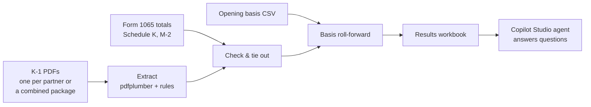

# k1-extractor

Python tool that reads partnership **Schedule K-1 (Form 1065)** PDFs, puts every
partner's numbers into one Excel workbook, ties the K-1s back to the Form 1065,
and rolls each partner's **outside basis** forward year by year.

> All data in this repository is fictional. "Harborview Sample Partners LP",
> its partners, IDs and amounts are invented for testing.

## Why

Reconstructing partner basis means reading every K-1 for every year, keying the
numbers, and checking that they agree with the partnership return. For a
partnership with dozens of partners and many years of K-1 packages, that's days
of manual work, and a single keying error carries into every later year.

This tool does the reading and checking in code, so each run gives the same
answer and every number can be traced back to a page of a PDF.

## How it works



1. **Extract.** Splits each PDF into K-1s (cover letters and other pages are
   skipped) and reads Items A-L and the Part III boxes, including coded boxes
   like 13W and 19A. Every pattern lives in one place, `extract.py`, so it can
   be adapted to a different software vendor's K-1 layout.
2. **Check.** Flags K-1s whose capital account (Item L) doesn't foot, a capital
   method other than tax basis, box 19 distributions that don't match Item L,
   duplicates, amended and final K-1s, missing fields, and scanned pages with
   no text layer.
3. **Tie out.** Totals the K-1s and compares them to the Form 1065: the number
   of K-1s, each Schedule K line, Schedule M-2 capital, partners' share of
   liabilities, and Item J percentages adding to 100%.
4. **Roll basis forward.** Chains outside basis from year to year in the
   regulatory order (details below), tracking section 731 gain and section
   704(d) suspended losses.
5. **Write Excel.** Tabs: Summary, File Inventory, Partner Master, K-1 Detail,
   Box Detail, Exceptions, Control Totals, Basis Rollforward.

Each partner gets one master number in order of first appearance. A
profits-interest K-1 issued to someone who also holds a capital interest is
kept as a **separate partner**.

## Quick start

```bash
pip install -r requirements.txt

# make fresh fake K-1s (two years, with a few errors planted on purpose)
python -m k1_extractor.fake_k1s samples

# run the tool
python -m k1_extractor samples --opening-basis samples/opening_basis.csv --out output/k1_results.xlsx
```

Output on the sample data:

```
K-1s extracted: 9  partners: 5
Control totals that don't tie: 1
  2025 Schedule M-2 - Ending capital: K-1s 600,100.00 vs 1065 600,000.00
Errors: 1
  2025 P-001 Item L foots: Ending capital 303,000 vs computed 302,900 (difference 100)
```

That's the planted error: one K-1 misprints ending capital by $100. The K-1
check catches it on the partner's own form, and the tie-out catches it again at
the partnership level. Run `python -m k1_extractor.fake_k1s samples --no-errors`
for data that ties cleanly.

### Folder layout

```
samples/
  opening_basis.csv          partner_id, beginning_basis, suspended_losses
  2024/
    K-1 2024 P-001.pdf ...   one PDF per partner
    form1065_totals.json     Schedule K, M-2 and liability totals from the 1065
  2025/
    K-1 package 2025.pdf     one combined package with a cover letter
    form1065_totals.json
```

## Basis roll-forward

Ordering follows the basis worksheet in the IRS Partner's Instructions for
Schedule K-1 (Form 1065), IRC sections 705, 731, 733 and 752, and Treas. Reg.
1.704-1(d)(2):

1. **Increase** for contributions, income items, tax-exempt income, and any
   increase in the partner's share of liabilities (section 752(a)).
2. **Decrease** for distributions, including any decrease in the share of
   liabilities, which is a deemed distribution (section 752(b)). Anything above
   basis is gain under section 731(a); basis stops at zero.
3. **Decrease** for nondeductible, noncapital expenses (box 18C).
4. **Decrease** for losses and deductions, including losses suspended from
   earlier years. Anything above the remaining basis is suspended and carried
   forward (section 704(d)).

Guaranteed payments (box 4) don't change basis.

The sample data exercises each path. One partner's losses exceed basis two
years running. A profits interest gets a distribution larger than its basis. A
new partner contributes capital and picks up a share of liabilities. An
existing partner's liability share falls, creating a deemed distribution. The
tests check each result against a hand calculation.

**Simplifications.** Suspended losses are tracked as one pool rather than by
character. Property distributions are taken at the box 19 amount. At-risk
(section 465) and passive activity (section 469) limits, which apply after
basis, aren't computed. Section 704(c), 743(b) and 734(b) adjustments aren't
modeled.

## Copilot Studio agent

The [`agent/`](agent/) folder has instructions for a Microsoft Copilot Studio
agent that answers questions from the results workbook, such as "show partner
P-004's basis from 2024 to 2025" or "which years don't tie to the 1065?"

The split is deliberate. Python does the extraction and math, the parts that
must be repeatable and testable. The agent makes the results easy to ask about,
and it must cite the tab it used and warn when a year doesn't tie.

## Tests

```bash
pytest
```

20 tests, all on freshly generated fake K-1s: amount parsing, PDF splitting,
field extraction, planted-error detection, tie-out differences, duplicate
K-1s, and basis results checked against hand calculations.

## Keeping real data out

`.gitignore` blocks every PDF, Excel and CSV file except the fictional ones in
`samples/`. Run real K-1s from a folder outside this repository.

## Limitations and next steps

- Scanned K-1s (older years) need OCR first; those pages are flagged.
- Real K-1 layouts vary by tax software. Expect to adjust the patterns in
  `extract.py` with the `unparsed_lines` the tool reports.
- Next: read the K-1 footnote statements, add section 704(c), 743(b) and 734(b)
  flags, and track suspended losses by character.

---

Built by Angie Jenkins, EA, with Claude Code.
